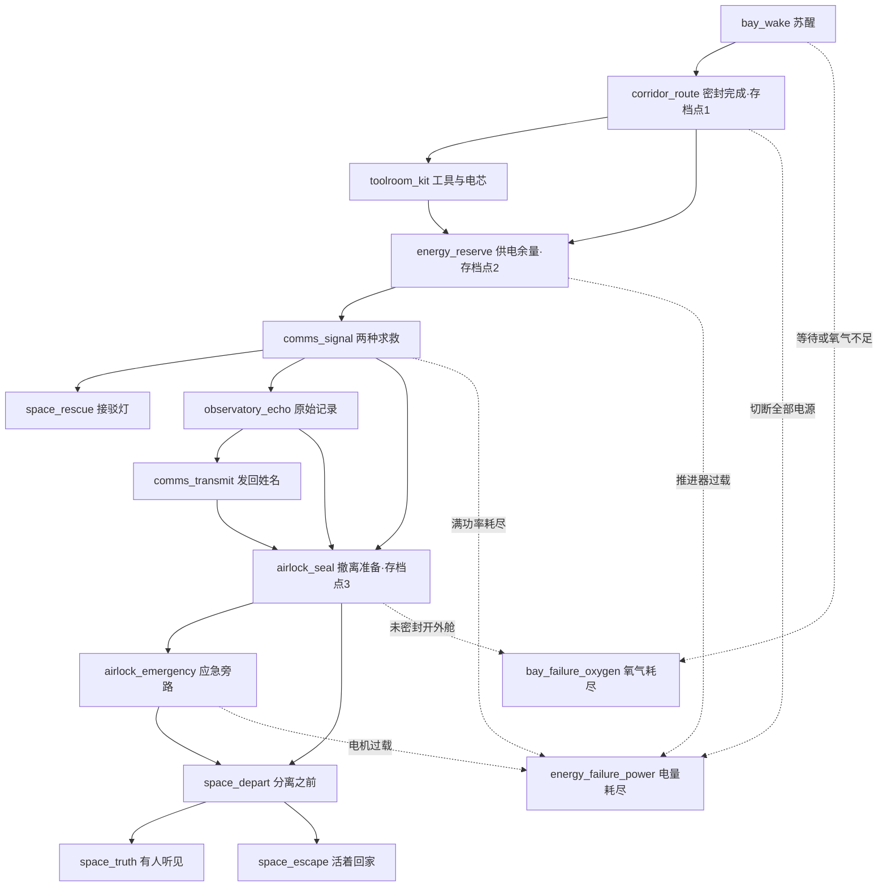

# 《深空回声 · 影像版》剧情结构

负责人：LQ。本文件给组员看，含剧透。使用同一 Python 核心；与可往返探索的 `stories/deep_space/` 独立。影像版只放在 `stories/film/`，不上文字书架或原桌面菜单。

试玩入口：`/cinematic?story=deep_space_film`。每个选择进入下一段画面，无回路、无原地解谜插件操作。所有场景 ID 都以现有飞船画面键开头，不需要新增画面。

## 剧情主线与分支

“回声号”的最后一名值班员在失压中醒来。上一班船员留下的求救被系统循环了三年。玩家先保存生命，再决定是否把被删去的姓名送回地球。跳过工具会改走耗电的应急开门；过载与原地等待会立即付出失败代价。



其余非结局节点也提供“留在原地，等到氧气耗尽”的不可逆分支，图中省略这些重复边；资源不足时另提供明确标注的失败选择。每个失败节点都由选择直接进入。

## 资源与失败规则

- 初始氧气 **12**、电量 **10**，作为公开资源显示；无虚假的固定上限。
- 普通前进选择通常各消耗 1。直奔能源舱/应急开门消耗 2 电量，发送记录消耗 2 电量，接受救援消耗氧气和电量各 2。成本写在各 choice.effects 中，**没有额外 every_turn 重复扣费**。
- 前进选择只在扣费后两种资源仍大于 0 时可用；不足时选择“仍试图继续/仍强行启动设备”直接进入对应失败结局，并将该资源置 0。
- 等到氧气耗尽、未密封就打开外舱门，使氧气归零；切断备用电源或持续过载，使电量归零。立即进入 `fail_oxygen` / `fail_power`，不会以资源 0 的普通场景继续游戏。
- 接入独立电芯恢复生命维持时，先支付该选择的正常成本，再增加氧气和电量各 6；电芯消耗。工具包保留用于气闸修复。
- 查看笔记/快照不扣资源；本版没有概率事件，同一条选择路线结果固定。脚本仍声明 seed=6181，兼容回放工具。
- 失败惩罚暂沿用播放器：`fail_` 前缀；回到上一个选择消耗一次机会，全局 3 次。回到关键节点不扣机会，但后续进度/节点作废。规则由 ZC 播放器及后续 ZQO 会话实现，剧本不私设第二套机会计数。

## 五个结局及通关脚本

| 结局 ID | 类型 | 达成条件 | 脚本 |
| --- | --- | --- | --- |
| `escape` | 普通 | 完成密封撤离，沿信标返航 | `walkthroughs/escape.txt` |
| `truth` | 普通 | 下载原始记录并发回地球，随后撤离 | `walkthroughs/truth.txt` |
| `rescue` | 普通 | 通信室发送定位，保留足够资源接受接驳 | `walkthroughs/rescue.txt` |
| `fail_oxygen` | 失败 | 氧气耗尽；示例为密封后原地等待 | `walkthroughs/fail_oxygen.txt` |
| `fail_power` | 失败 | 电量耗尽；示例为切断全部备用电源 | `walkthroughs/fail_power.txt` |

总计 15 个场景（10 个过程、5 个结局）。普通结局保留正资源；失败结局的对应资源恰为 0。没有后台触发器把玩家悄悄送到失败节点，每次失败都有可回退的实际选择。

## 三个关键节点

| 场景 | 临时存档点名称 | 保留的决策 |
| --- | --- | --- |
| `corridor_route` | 密封完成 · 出发前 | 是否搜集工具与电芯 |
| `energy_reserve` | 供电余量 · 能源舱 | 是否恢复生命维持，如何分配供电 |
| `airlock_seal` | 撤离准备 · 气闸前 | 可靠修复或耗电旁路 |

目前使用 `on_enter: [{"say": "【存档点】名称"}]`。名称唯一；后续 YHT/ZQO 正式字段 contract 合入时再迁移，不预先添加尚未支持的 checkpoint/art/ending.kind。

## 存储接入与跨端

LQ 后端已在 `web/storage/cinematic.js` 和 `taleloom/storage.py` 提供同一检查点容器，内部每个 save 仍是标准 v1 存档。

```text
{checkpoint_version: 1, story_id, entries: [{label, scene, turn, at, save}]}
```

网页：`CinematicSaveStore(storyId).readEntries()/writeEntries(entries)`；桌面：`CheckpointStore(FileSaveStore(folder), story_id).read_entries()/write_entries(entries)`。两者支持容器导入导出；每个 entry.save 也能单独交给会话恢复。一次原子替换整个容器，用于回退后裁剪，保留旧档并报告写入失败。浏览器兼容旧影像存档键，迁移失败时仍可读取旧数据。

**播放器调用、通用集成/浏览器测试由 ZC 在 [issue #26](https://github.com/zoran-sid/TaleLoom/issues/26) 接入。** LQ 遵照本轮“只改自己的文件”，未修改 `web/cinematic/`、桌面 GUI 或共享类型；不能把后端测试通过记作影像页面已经使用正式存储。

## 验证入口

```bash
python -B main.py validate
python -B main.py replay deep_space_film
python -B -m taleloom.replay --seed 6181 --runs 30 --steps 100
python -B -m unittest discover -s tests/lq -t .
npm run test:storage
```

探索器现枚举文字版和 `stories/film/`。真实影像集成测试的雾港硬编码及 CI 探索目录由 #26 交 ZC 修正，结果以 PR 的实际验证记录为准，不跳过失败检查。
